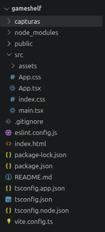
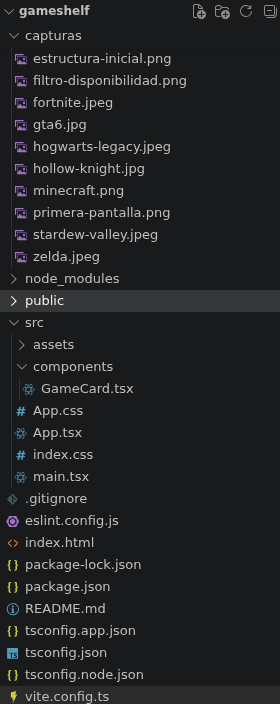
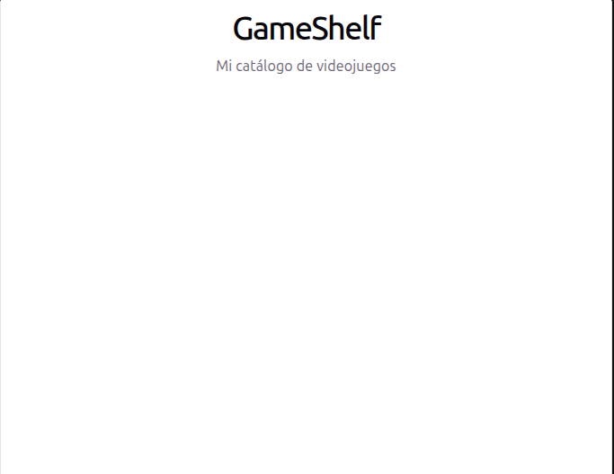

# Actividad 02. Mi primera app con React

### Somil Vasandani 2ºDAM

# Sesión 1 — Preparación e interfaz

## ¿Qué es React? ¿Es un lenguaje, una biblioteca o una herramienta para crear proyectos?

React es una biblioteca de JavaScript de código abierto creada por Meta (Facebook) para construir interfaces de usuario con el objetivo de facilitar el desarrollo de aplicaciones en una sola página.

https://es.wikipedia.org/wiki/React

## ¿Qué diferencia hay entre create-vite y Vite? ¿Qué hace Vite mientras ejecutamos npm run dev? ¿Qué crees que hará npm run build?

La diferencia principal es que Vite es la herramienta de construcción y el servidor de desarrollo en sí, mientras que create-vite es el asistente o generador que se usa para crear la estructura inicial de un proyecto de Vite.

https://es.vite.dev/guide/ 

## ¿Qué son Node.js y npm? ¿Para qué usamos npm create, npm install y npm run dev?

`Node.js` es un entorno de ejecución para JavaScript que permite ejecutar código fuera del navegador. Mientras que `npm` es el gestor de paquetes oficial de `Node.js`. Viene instalado por defecto con `Node.js`

https://recursoswebyseo.com/desarrollo-web/node-js-npm-para-principiantes/ 

https://kinsta.com/es/blog/que-es-npm/

## ¿Qué son las dependencias? ¿Por qué aparece node_modules?

Las dependencias son bloques de código o librerías desarrolladas por terceros que instalas para no programar todo desde cero.
La carpeta node_modules aparece porque es el almacén físico donde se descargan automáticamente esas librerías cuando ejecutas `npm install`. `Node.js` las guarda ahí de forma local para que tu proyecto pueda utilizarlas al ejecutarse.

## ¿Qué añade TypeScript a JavaScript?

TypeScript añade tipado estático a JavaScript, lo que te obliga a definir qué tipo de dato (texto, número, objeto) guarda cada variable o recibe cada función.

## ¿Qué significan JSX y TSX?

JSX y TSX son extensiones de archivo que permiten escribir código HTML directamente dentro de JavaScript y TypeScript, facilitando la creación de interfaces visuales.
JSX significa JavaScript XML y es la sintaxis estándar utilizada en librerías como React; te permite diseñar la estructura de tu página web combinando la lógica de programación y el diseño visual en un mismo lugar. Por otro lado, TSX significa TypeScript XML y es exactamente lo mismo, pero añade la capa de tipado fuerte de TypeScript. Esto significa que TSX no solo te permite maquetar visualmente, sino que además verifica que los datos que pasas a tus componentes visuales sean los correctos antes de ejecutar la aplicación.

# 4. Investiga los archivos


| Archivo/carpeta | Pregunta para investigar | Función (con tus palabras) |
| :--- | :--- | :--- |
| index.html | ¿Qué elemento tiene id="root"? | Un contenedor `<div>` que sirve como punto de anclaje donde React monta y dibuja toda la aplicación. |
| src/main.tsx | ¿Qué componente importa? ¿Dónde aparece createRoot? | Importa el componente `App`. Usa `createRoot` al inicio para conectar la lógica de React con el HTML real. |
| src/App.tsx | ¿Qué interfaz se muestra? | Define la pantalla principal o el componente inicial que el usuario ve al cargar la aplicación. |
| src/App.css | ¿Qué reglas visuales aparecen? | Contiene los estilos visuales específicos (colores, márgenes, alineaciones) aplicados únicamente al componente App. |
| src/index.css | ¿En qué se diferencia de App.css? | Define los estilos globales de la aplicación (como la tipografía base o el fondo) que afectan a toda la web. |
| package.json | ¿Qué comandos aparecen en scripts? | Comandos de control como `dev` (para arrancar el servidor local), `build` (para compilar) y `preview`. |
| tsconfig.json | ¿Qué indica "ts"? ¿Necesitas editarlo hoy? | Indica TypeScript. Configura las reglas del compilador del lenguaje y no necesitas editarlo en este momento. |
| vite.config.ts | ¿Qué nombre de herramienta aparece? | Aparece Vite, que funciona como el motor y servidor de desarrollo rápido que empaqueta todo tu proyecto. |
| public/ y src/assets/ | ¿Qué recursos encuentras? | Archivos estáticos de la aplicación como imágenes, logotipos, iconos o fuentes** necesarias para el diseño. |
| node_modules/ | ¿Qué contiene? ¿Por qué no se sube? | Contiene las librerías externas instaladas. No se sube por su excesivo peso, ya que cualquiera puede regenerarla con `npm install`. |
| .gitignore | ¿Qué archivos o carpetas ignora Git? | Indica a Git que no rastree archivos pesados o confidenciales, excluyendo carpetas como `node_modules/` o carpetas de producción. |


# 5. Capturas que debe incluir el README.md

## Estructura del proyecto en VS Code

Estructura inicial:



Estructura final:



## Primera pantalla de GameShelf



## Filtro de disponibilidad activo


## Aplicación final con el filtro de precio


## Filtro precio < 15 €


# 8. Añade datos y muestra tres tarjetas

## 1. ¿Qué es una función?

Función es un bloque de código reutilizable diseñado para realizar una tarea específica.

## 2. ¿Qué diferencia hay entre definirla y llamarla?

Definir una función es escribir su código y darle un nombre. Consiste en programar las instrucciones y guardarlas en la memoria, pero el ordenador todavía no las ejecuta.
Llamar una función es ordenar al programa que se ejecute. Consiste en usar el nombre de la función para que el ordenador realice las instrucciones que habías guardado en su definición.

## 3. ¿Qué recibe el parámetro game en cada vuelta?

En cada iteración del método `.map()`, el parámetro game recibe un objeto individual del array games. Específicamente, en la primera vuelta recibe el objeto de Hollow Knight, en la segunda el de Celeste, y en la tercera el de Stardew Valley.

## 4. ¿Qué devuelve la función flecha dentro de map()?

Devuelve un componente visual `<GameCard />` configurado con las propiedades específicas (title, genre, price, available y key) extraídas del videojuego de esa vuelta. Al final, `.map()` recolecta todas estas devoluciones y genera una lista de componentes listos para renderizarse en pantalla.

Enlace: https://developer.mozilla.org/es/docs/Web/JavaScript/Guide/Functions 

# 9. Investiga y crea los estilos CSS

## APP.css:

```css

* {
  box-sizing: border-box;
}

:root {
  font-family: Arial, sans-serif;
  color: #eeeeee;
  background: #171a21;
}

body {
  margin: 0;
  min-width: 320px;
  min-height: 100vh;
  background: #171a21;
}

button {
  font: inherit;
}

.app {
  max-width: 1200px;
  margin: 0 auto;
  padding: 40px 25px;
}

.app h1 {
  margin: 0;
  color: #ffffff;
  font-size: 2.8rem;
  text-align: center;
}

.app > p {
  margin: 12px 0 28px;
  color: #b8bdc9;
  line-height: 1.5;
  text-align: center;
}

/* Filtros */

.app > button {
  padding: 10px 15px;
  margin: 0 8px 25px 0;
  border: 1px solid #414653;
  border-radius: 5px;
  background: #252a34;
  color: #eeeeee;
  cursor: pointer;
}

.app > button:hover {
  background: #353c49;
}

/* Catálogo */

.catalog {
  display: grid;
  grid-template-columns: repeat(5, minmax(0, 1fr));
  gap: 22px;
}

/* Juegos */

.card {
  min-width: 0;
  overflow: hidden;
  border: 1px solid #343a46;
  border-radius: 8px;
  background: #222630;
}

.card:hover {
  border-color: #65718a;
}

.card-image {
  display: block;
  width: 100%;
  aspect-ratio: 3 / 4;
  object-fit: cover;
  background: #303642;
}

.card-content {
  padding: 16px;
}

.card-genre {
  margin: 0 0 8px;
  color: #a6b5d4;
  font-size: 0.8rem;
  font-weight: bold;
  text-transform: uppercase;
}

.card h2 {
  margin: 0 0 12px;
  color: #ffffff;
  font-size: 1.2rem;
  line-height: 1.4;
  overflow-wrap: anywhere;
}

.card p {
  color: #c0c4cd;
  line-height: 1.5;
}

.card-status {
  display: inline-block;
  padding: 5px 8px;
  border-radius: 4px;
  font-size: 0.8rem;
  font-weight: bold;
}

.card-status.available {
  background: #244333;
  color: #a4e0b8;
}

.card-status.unavailable {
  background: #492b30;
  color: #f0b0b6;
}

.card-footer {
  display: flex;
  align-items: center;
  justify-content: space-between;
  gap: 10px;
  margin-top: 16px;
  padding-top: 12px;
  border-top: 1px solid #3a3f4a;
}

.card-price {
  color: #ffffff;
  font-size: 1.25rem;
  font-weight: bold;
}

.empty-message {
  grid-column: 1 / -1;
  padding: 25px;
  border: 1px solid #414653;
  border-radius: 6px;
  color: #c0c4cd;
  text-align: center;
}

@media (max-width: 850px) {
  .catalog {
    grid-template-columns: repeat(2, minmax(0, 1fr));
    gap: 16px;
  }
}

@media (max-width: 550px) {
  .app {
    padding: 30px 15px;
  }

  .app h1 {
    font-size: 2.2rem;
  }

  .catalog {
    grid-template-columns: 1fr;
  }

  .app > button {
    width: 100%;
    margin-bottom: 10px;
  }

  .card {
    width: 100%;
    max-width: 400px;
    margin: 0 auto;
  }
}

```

# Sesión 3 — Interactividad, documentación y publicación

# 10. Añade el filtro de disponibilidad

## 10.1 Importa y utiliza useState

Arriba de `src/App.tsx` añadí este import junto al import de App.css y GameCard:

```js
import { useState } from "react";
```

Dentro de function App(), antes de return, añadí:

```js
const [onlyAvailable, setOnlyAvailable] = useState(false);
```

## 10.2 Calcula qué juegos mostrar

Debajo del estado y antes del return, escribí:

```js
const visibleGames = onlyAvailable
  ? games.filter((game) => game.available)
  : games;
```

## 10.3 Añade el botón

Dentro del return, debajo del párrafo, añadí:

```js
<button onClick={() => setOnlyAvailable(!onlyAvailable)}>
  {onlyAvailable ? "Mostrar todos" : "Mostrar disponibles"}
</button>
```

### Qué diferencia hay entre estado y variable normal, y qué hace onClick.


+ Variable normal: Guarda el dato, pero no avisa a la pantalla. Si el valor cambia, la interfaz se queda igual y el usuario no ve ninguna actualización.
+ Estado (useState): Guarda el dato y avisa a React en cuanto cambia. Al recibir el aviso, React vuelve a pintar el componente y muestra el nuevo valor al usuario.

### ¿Qué hace onClick?

Es un botón. Detecta el momento exacto en el que el usuario pulsa un elemento y ejecuta la función que le hayas asignado.

## Reto 11: juegos por menos de 15 €

### ¿Qué he hecho?

Primero he creado un segundo estado para saber si el filtro de precio está activado:

```js
const [onlyUnder15, setOnlyUnder15] = useState(false);
```
Empieza en `false`, por lo que al principio no se aplica el filtro de precio.

Después he mantenido el filtro de disponibilidad:

```js
let visibleGames = onlyAvailable ? games.filter((game) => game.available) : games;
```

Esto significa que `visibleGames` contiene todos los juegos o solamente los disponibles, dependiendo de si `onlyAvailable` está activado.

Después he aplicado el segundo filtro sobre `visibleGames`:

```js
visibleGames = visibleGames.filter((game) => game.price < 15);
```

De esta forma los filtros se pueden combinar. Por ejemplo, si los dos están activados, primero se muestran los juegos disponibles y después, de esos juegos, solamente los que cuestan menos de 15 €.

También he añadido un segundo botón:

`<button onClick={() => setOnlyUnder15(!onlyUnder15)}>`

El `!` sirve para invertir el estado: si es `true`, pasa a `false`; si es `false`, pasa a `true`.

Finalmente, he cambiado el `map()` para que utilice `visibleGames`:

`visibleGames.map((game) => ...)`

Así se muestran solamente los juegos que cumplen los filtros activos.

### Preguntas

#### ¿Qué significa `game.price < 15`?

Significa que el precio del juego (`game.price`) tiene que ser menor que 15.

#### ¿Qué lista debe pasar por el segundo `filter()`?

Debe pasar `visibleGames`.

Esto es importante porque `visibleGames` ya tiene aplicado el filtro de disponibilidad.

Si utilizáramos `games.filter(...)` otra vez, perderíamos el primer filtro cuando los dos estuvieran activados.

Por eso hacemos:

`visibleGames = visibleGames.filter((game) => game.price < 15);`

#### ¿Cómo inviertes el estado?

Usamos el signo `!`:

`setOnlyUnder15(!onlyUnder15)`

Si `onlyUnder15` es `false`, `!onlyUnder15` es `true`.

Si `onlyUnder15` es `true`, `!onlyUnder15` es `false`.

Así, cada vez que pulsamos el botón, el filtro se activa o se desactiva.

#### ¿Qué texto verá la persona en cada estado?

Para el filtro de disponibilidad:

- Si está desactivado -> "Solo disponibles"
- Si está activado -> "Mostrar todos"

Para el filtro de precio:

- Si está desactivado -> "Menos de 15 €
- Si está activado -> "Mostrar todos los precios"

Esto se consigue utilizando un operador ternario:

`{onlyUnder15 ? "Mostrar todos los precios" : "Menos de 15 €"}`

El texto cambia automáticamente dependiendo de si el estado es `true` o `false`.

# 13. Reflexión

## 1. ¿Qué archivo conecta el HTML con App?

El archivo `main.tsx`, que carga el componente App y lo muestra en el HTML.

## 2. ¿Qué diferencias hay entre React, TypeScript y Vite?

+ React: sirve para crear la interfaz de la aplicación.
+ TypeScript: es JavaScript con tipos, que ayuda a detectar errores.
+ Vite: sirve para ejecutar el proyecto durante el desarrollo y compilarlo para publicarlo.

## 3. ¿Qué son las props de GameCard?

Son los datos que recibe el componente `GameCard` para mostrar la información de cada juego, como el título, el género, el precio y si está disponible.

## 4. ¿Por qué usamos setOnlyAvailable para cambiar el estado?

Porque es la función que nos permite actualizar el estado onlyAvailable. Cuando cambia, React vuelve a mostrar la aplicación con los datos actualizados.

## 5. ¿Qué hacen map() y filter()?

+ map() recorre un array y permite mostrar cada juego mediante un componente `GameCard`.
+ filter() crea un array nuevo con los juegos que cumplen una condición, como estar disponibles o costar menos de 15 €.

## 6. ¿Para qué sirve key?

Sirve para que React identifique cada elemento de una lista y pueda actualizarlo correctamente. En mi caso, usé el identificador de cada juego: key={game.id}.

## 7. ¿Qué error te costó más resolver y cómo lo solucionaste?

El error que más me costó fue conseguir que los filtros funcionaran correctamente. Lo solucioné utilizando visibleGames en el map() en lugar de games, para mostrar únicamente los juegos que cumplen las condiciones seleccionadas.
