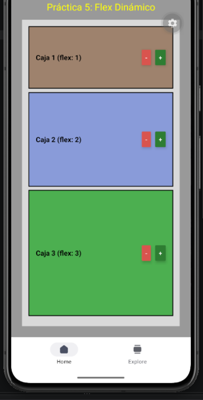
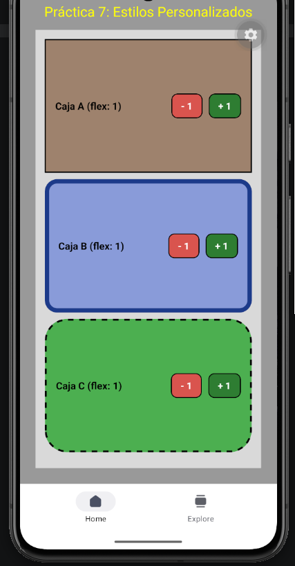
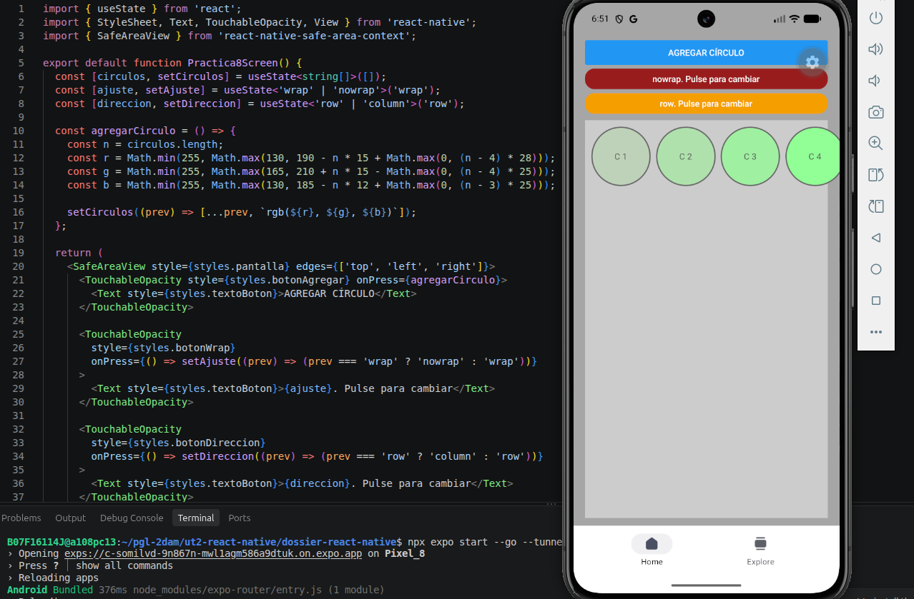

# Dossier de React Native con Expo y Android Studio

### Somil Vasandani Dhanwani 2ºDAM

## Práctica 1.
Una vez configurado e instalado lo pedido, he modificado el `src/app/index.tsx` (cambié el color de fondo a rojo) y el resultado es el siguiente:


### Paso 2. Contador


## Práctica 2.

Para llevar a cabo esta práctica, modifiqué el codigo anterior por el siguiente código:

```react
import { useState } from 'react';
import { Button, StyleSheet, Text, View } from 'react-native';

export default function ContadorScreen() {
  const [contador, setContador] = useState(0);

  return (
    <View style={styles.pantalla}>
      <View style={styles.caja}>
        <Text style={styles.texto}>Contador: {contador}</Text>
        <Button title="Incrementar" onPress={() => setContador(n => n + 1)} />
        <View style={styles.separacion} />
        <Button title="Decrementar" onPress={() => setContador(n => n - 1)} />
      </View>
    </View>
  );
}

const styles = StyleSheet.create({
  pantalla: {
    flex: 1,
    justifyContent: 'center',
    alignItems: 'center',
  },
  caja: {
    alignItems: 'center',
    borderWidth: 2,
    borderColor: 'royalblue',
    backgroundColor: 'aliceblue',
    borderRadius: 15,
    padding: 20,
  },
  texto: {
    fontSize: 18,
    marginBottom: 10,
  },
  separacion: {
    height: 10,
  },
});

```

Resultado:


## Práctica 3. InicioScreen y estilos separados

En esta práctica he reorganizado la estructura del proyecto separando las pantallas en la carpeta `src/screens/` y dejando `src/app/` únicamente para gestionar las rutas de Expo Router:

- `src/screens/HolaMundoScreen.tsx`: Guarda la pantalla de la Práctica 1 para no perder el ejercicio anterior.
- `src/screens/InicioScreen.tsx`: Contiene la lógica y los estilos (`StyleSheet.create()`) del contador de la Práctica 2.
- `src/app/index.tsx`: Importa y muestra `<InicioScreen />` como pantalla principal.

Código de `src/app/index.tsx`:

```tsx
import InicioScreen from '../screens/InicioScreen';

export default function Index() {
  return <InicioScreen />;
}
```

Además, he dejado preparado el componente reutilizable `src/components/Caja.tsx` para trabajar con Flexbox en las siguientes prácticas.

El resultado es el mismo que el de la práctica anterior debido a que solo he reorganizado la estructura.

## Práctica 4. Tres cajas

En esta práctica he creado la pantalla `src/screens/PrincipalScreen.tsx` siguiendo el diseño del dossier: un fondo gris con el título amarillo «Contenedor Principal» y un escenario interior con `flex: 1` donde se apilan tres componentes `Caja` de 100 × 100 con borde negro y distintos colores pasados por propiedades (`bg`).

Código de `src/screens/PrincipalScreen.tsx`:

```tsx
import { StyleSheet, Text, View } from 'react-native';
import Caja from '../components/Caja';

export default function PrincipalScreen() {
  return (
    <View style={styles.pantalla}>
      <Text style={styles.titulo}>Contenedor Principal</Text>
      <View style={styles.escenario}>
        <Caja bg="#9e826c" />
        <Caja bg="#899bd9" />
        <Caja bg="#107c10" />
      </View>
    </View>
  );
}
```

Resultado:


## Práctica 5. Modificar flex dinámicamente

Para no perder la práctica anterior, he creado el componente `src/components/CajaFlex.tsx` y la pantalla `src/screens/Practica5Screen.tsx`. Cada caja mantiene su propio estado independiente (`valorFlex`) y cuenta con dos botones (`+` y `-`) que modifican su proporción evitando valores negativos mediante `Math.max(0, n - 1)`. Además, he sustituido la altura fija por `minHeight` para que se aprecie cómo se reparten el espacio libre del escenario.

Código de `src/components/CajaFlex.tsx`:

```tsx
import { useState } from 'react';
import { Button, StyleSheet, Text, View } from 'react-native';

type Props = { nombre: string; bg?: string };

export default function CajaFlex({ nombre, bg = 'green' }: Props) {
  const [valorFlex, setValorFlex] = useState(0);

  return (
    <View style={[styles.caja, { backgroundColor: bg, flex: valorFlex }]}>
      <Text style={styles.texto}>{nombre} (flex: {valorFlex})</Text>
      <View style={styles.botones}>
        <Button title="-" color="#d9534f" onPress={() => setValorFlex(n => Math.max(0, n - 1))} />
        <Button title="+" color="#2e7d32" onPress={() => setValorFlex(n => n + 1)} />
      </View>
    </View>
  );
}
```

Resultado:



## Práctica 6. Sustituir los botones

Para mantener intacta la práctica anterior, he creado el componente `src/components/CajaTouch.tsx` y la pantalla `src/screens/Practica6Screen.tsx`. En cada caja he sustituido los botones nativos por componentes táctiles personalizados:
* **`TouchableHighlight`** para `flex + 1`: muestra un resaltado oscuro al pulsar (`underlayColor`), lanza una alerta con `Alert.alert()` e incrementa el valor de `flex`.
* **`TouchableOpacity`** para `flex - 1`: reduce su opacidad al pulsar y disminuye el valor de `flex` sin bajar de cero.

Código de los botones en `src/components/CajaTouch.tsx`:

```tsx
<TouchableOpacity
  style={[styles.boton, styles.botonRestar]}
  activeOpacity={0.6}
  onPress={() => setValorFlex((n) => Math.max(0, n - 1))}
>
  <Text style={styles.textoBoton}>- 1</Text>
</TouchableOpacity>

<TouchableHighlight
  style={[styles.boton, styles.botonSumar]}
  underlayColor="#1b5e20"
  onPress={incrementar}
>
  <Text style={styles.textoBoton}>+ 1</Text>
</TouchableHighlight>
```

Resultado (mostrando la alerta al incrementar):


## Práctica 7. Nombre y estilos personalizados

Para conservar la práctica anterior sin modificaciones, he creado `src/components/CajaPersonalizada.tsx` y la pantalla `src/screens/Practica7Screen.tsx`. El componente recibe una propiedad opcional `style?: StyleProp<ViewStyle>` que se combina al final del arreglo de estilos (`[styles.caja, { backgroundColor: bg, flex: valorFlex }, style]`), permitiendo sobrescribir el borde y el radio desde la pantalla padre.

Código de uso en `src/screens/Practica7Screen.tsx`:

```tsx
<CajaPersonalizada nombre="Caja A" bg="#9e826c" />
<CajaPersonalizada
  nombre="Caja B"
  bg="#899bd9"
  style={{ borderRadius: 20, borderWidth: 7, borderColor: '#1e3a8a' }}
/>
<CajaPersonalizada
  nombre="Caja C"
  bg="#4caf50"
  style={{ borderRadius: 35, borderStyle: 'dashed', borderWidth: 3 }}
/>
```

Resultado:



## Práctica 8. Círculos dinámicos

Para mantener las prácticas anteriores sin modificaciones, he creado `src/screens/Practica8Screen.tsx` y la he enlazado en el índice principal. La pantalla parte de un escenario vacío y dispone de tres controles personalizados con `TouchableOpacity` para añadir círculos de color variable (limitando cada canal RGB mediante `Math.min(255, valor)`) y alternar dinámicamente las propiedades Flexbox `flexWrap` (`wrap`/`nowrap`) y `flexDirection` (`row`/`column`).

Código principal en `src/screens/Practica8Screen.tsx`:

```tsx
const agregarCirculo = () => {
  const n = circulos.length;
  const r = Math.min(255, Math.max(130, 190 - n * 15 + Math.max(0, (n - 4) * 28)));
  const g = Math.min(255, Math.max(165, 210 + n * 15 - Math.max(0, (n - 4) * 25)));
  const b = Math.min(255, Math.max(130, 185 - n * 12 + Math.max(0, (n - 3) * 25)));

  setCirculos((prev) => [...prev, `rgb(${r}, ${g}, ${b})`]);
};
```

```tsx
<View
  style={[
    styles.escenario,
    { flexDirection: direccion, flexWrap: ajuste },
  ]}
>
  {circulos.map((color, index) => (
    <View
      key={index}
      style={[styles.circulo, { backgroundColor: color }]}
    >
      <Text style={styles.textoCirculo}>C {index + 1}</Text>
    </View>
  ))}
</View>
```

**Problema encontrado y solución:** Al probar la pantalla en el emulador, el botón superior `AGREGAR CÍRCULO` quedaba cubierto por la barra de estado y la cámara frontal de Android, impidiendo pulsarlo. Se resolvió envolviendo la vista en `SafeAreaView` (`react-native-safe-area-context`) con `edges={['top', 'left', 'right']}`.

Resultado:




## Práctica 9 - Alineación Flexbox y componente Image

En esta práctica se trabaja la distribución dinámica de elementos en pantalla mediante Flexbox y la carga de imágenes desde distintas fuentes en React Native.

### Funcionalidades implementadas
* **Control de `justifyContent`:** Uso de un campo de texto (`TextInput`) para escribir y aplicar en tiempo real valores de alineación sobre el eje principal (`flex-start`, `flex-end`, `center`, `space-between`, `space-around`, `space-evenly`).
* **Control de `alignItems`:** Botonera interactiva (`TouchableOpacity`) que permite alternar la alineación en el eje secundario (`stretch`, `center`, `flex-start`, `flex-end`).
* **Carga de imágenes (`Image`):** Combinación de recursos locales importados mediante `require()` y recursos externos cargados a través de su URL con la propiedad `{ uri: '...' }`.

### Capturas

#### Práctica 9 - Control de alineación e imágenes


#### Práctica 9.1 - Selector de imagen aleatoria
En esta variante se gestiona un arreglo de imágenes locales mediante `useState`, mostrando una imagen distinta de forma aleatoria cada vez que se pulsa el botón y ajustando su escala con `resizeMode="contain"`.


