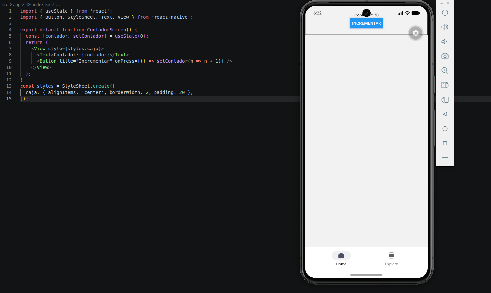

# Dossier de React Native con Expo y Android Studio

### Somil Vasandani Dhanwani 2ºDAM

## Práctica 1.
Una vez configurado e instalado lo pedido, he modificado el `src/app/index.tsx` (cambié el color de fondo a rojo) y el resultado es el siguiente:

### Paso 2. Contador

## Práctica 2.
