# Dossier de React Native con Expo y Android Studio

### Somil Vasandani Dhanwani 2ºDAM

## Práctica 1.
Una vez configurado e instalado lo pedido, he modificado el `src/app/index.tsx` (cambié el color de fondo a rojo) y el resultado es el siguiente:

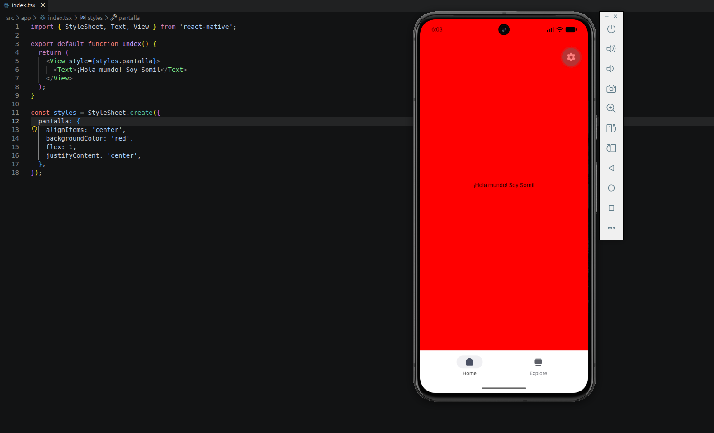

### Paso 2. Contador


## Práctica 2.

Para llevar a cabo esta práctica, modifiqué el codigo anterior por el siguiente código:

```react
import { useState } from 'react';
import { Button, StyleSheet, Text, View } from 'react-native';

export default function ContadorScreen() {
  const [contador, setContador] = useState(0);

  return (
    <View style={styles.pantalla}>
      <View style={styles.caja}>
        <Text style={styles.texto}>Contador: {contador}</Text>
        <Button title="Incrementar" onPress={() => setContador(n => n + 1)} />
        <View style={styles.separacion} />
        <Button title="Decrementar" onPress={() => setContador(n => n - 1)} />
      </View>
    </View>
  );
}

const styles = StyleSheet.create({
  pantalla: {
    flex: 1,
    justifyContent: 'center',
    alignItems: 'center',
  },
  caja: {
    alignItems: 'center',
    borderWidth: 2,
    borderColor: 'royalblue',
    backgroundColor: 'aliceblue',
    borderRadius: 15,
    padding: 20,
  },
  texto: {
    fontSize: 18,
    marginBottom: 10,
  },
  separacion: {
    height: 10,
  },
});

```

Resultado:

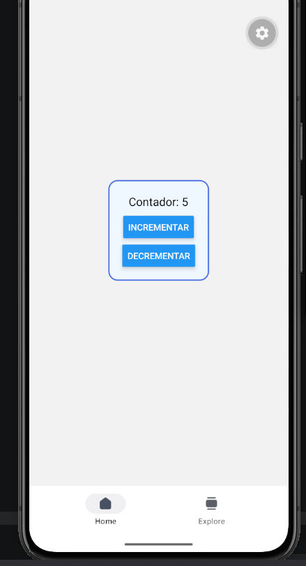

## Práctica 3. InicioScreen y estilos separados

En esta práctica he reorganizado la estructura del proyecto separando las pantallas en la carpeta `src/screens/` y dejando `src/app/` únicamente para gestionar las rutas de Expo Router:

- `src/screens/HolaMundoScreen.tsx`: Guarda la pantalla de la Práctica 1 para no perder el ejercicio anterior.
- `src/screens/InicioScreen.tsx`: Contiene la lógica y los estilos (`StyleSheet.create()`) del contador de la Práctica 2.
- `src/app/index.tsx`: Importa y muestra `<InicioScreen />` como pantalla principal.

Código de `src/app/index.tsx`:

```tsx
import InicioScreen from '../screens/InicioScreen';

export default function Index() {
  return <InicioScreen />;
}
```

Además, he dejado preparado el componente reutilizable `src/components/Caja.tsx` para trabajar con Flexbox en las siguientes prácticas.

El resultado es el mismo que el de la práctica anterior debido a que solo he reorganizado la estructura.

## Práctica 4. Tres cajas

En esta práctica he creado la pantalla `src/screens/PrincipalScreen.tsx` siguiendo el diseño del dossier: un fondo gris con el título amarillo «Contenedor Principal» y un escenario interior con `flex: 1` donde se apilan tres componentes `Caja` de 100 × 100 con borde negro y distintos colores pasados por propiedades (`bg`).

Código de `src/screens/PrincipalScreen.tsx`:

```tsx
import { StyleSheet, Text, View } from 'react-native';
import Caja from '../components/Caja';

export default function PrincipalScreen() {
  return (
    <View style={styles.pantalla}>
      <Text style={styles.titulo}>Contenedor Principal</Text>
      <View style={styles.escenario}>
        <Caja bg="#9e826c" />
        <Caja bg="#899bd9" />
        <Caja bg="#107c10" />
      </View>
    </View>
  );
}
```

Resultado:

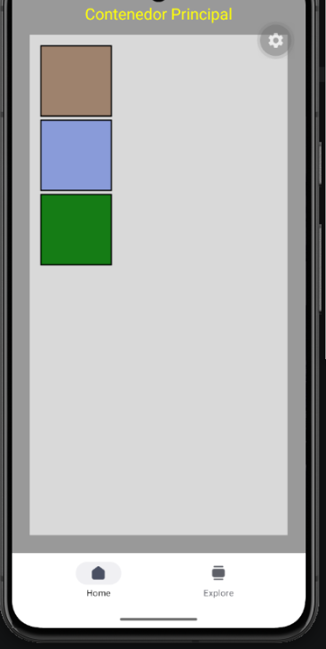

## Práctica 5. Modificar flex dinámicamente

Para no perder la práctica anterior, he creado el componente `src/components/CajaFlex.tsx` y la pantalla `src/screens/Practica5Screen.tsx`. Cada caja mantiene su propio estado independiente (`valorFlex`) y cuenta con dos botones (`+` y `-`) que modifican su proporción evitando valores negativos mediante `Math.max(0, n - 1)`. Además, he sustituido la altura fija por `minHeight` para que se aprecie cómo se reparten el espacio libre del escenario.

Código de `src/components/CajaFlex.tsx`:

```tsx
import { useState } from 'react';
import { Button, StyleSheet, Text, View } from 'react-native';

type Props = { nombre: string; bg?: string };

export default function CajaFlex({ nombre, bg = 'green' }: Props) {
  const [valorFlex, setValorFlex] = useState(0);

  return (
    <View style={[styles.caja, { backgroundColor: bg, flex: valorFlex }]}>
      <Text style={styles.texto}>{nombre} (flex: {valorFlex})</Text>
      <View style={styles.botones}>
        <Button title="-" color="#d9534f" onPress={() => setValorFlex(n => Math.max(0, n - 1))} />
        <Button title="+" color="#2e7d32" onPress={() => setValorFlex(n => n + 1)} />
      </View>
    </View>
  );
}
```

Resultado:


## Práctica 6. Sustituir los botones

Para mantener intacta la práctica anterior, he creado el componente `src/components/CajaTouch.tsx` y la pantalla `src/screens/Practica6Screen.tsx`. En cada caja he sustituido los botones nativos por componentes táctiles personalizados:
* **`TouchableHighlight`** para `flex + 1`: muestra un resaltado oscuro al pulsar (`underlayColor`), lanza una alerta con `Alert.alert()` e incrementa el valor de `flex`.
* **`TouchableOpacity`** para `flex - 1`: reduce su opacidad al pulsar y disminuye el valor de `flex` sin bajar de cero.

Código de los botones en `src/components/CajaTouch.tsx`:

```tsx
<TouchableOpacity
  style={[styles.boton, styles.botonRestar]}
  activeOpacity={0.6}
  onPress={() => setValorFlex((n) => Math.max(0, n - 1))}
>
  <Text style={styles.textoBoton}>- 1</Text>
</TouchableOpacity>

<TouchableHighlight
  style={[styles.boton, styles.botonSumar]}
  underlayColor="#1b5e20"
  onPress={incrementar}
>
  <Text style={styles.textoBoton}>+ 1</Text>
</TouchableHighlight>
```

Resultado (mostrando la alerta al incrementar):

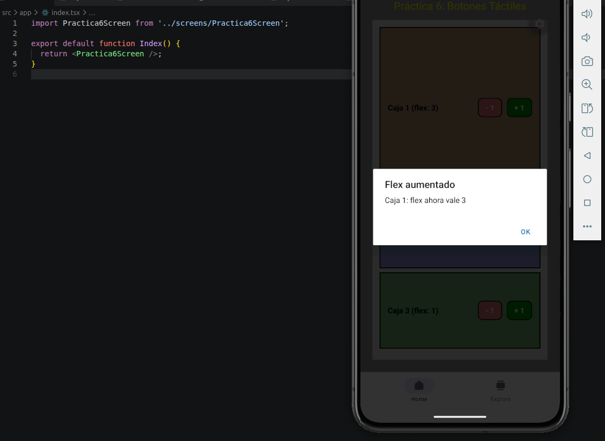

## Práctica 7. Nombre y estilos personalizados

Para conservar la práctica anterior sin modificaciones, he creado `src/components/CajaPersonalizada.tsx` y la pantalla `src/screens/Practica7Screen.tsx`. El componente recibe una propiedad opcional `style?: StyleProp<ViewStyle>` que se combina al final del arreglo de estilos (`[styles.caja, { backgroundColor: bg, flex: valorFlex }, style]`), permitiendo sobrescribir el borde y el radio desde la pantalla padre.

Código de uso en `src/screens/Practica7Screen.tsx`:

```tsx
<CajaPersonalizada nombre="Caja A" bg="#9e826c" />
<CajaPersonalizada
  nombre="Caja B"
  bg="#899bd9"
  style={{ borderRadius: 20, borderWidth: 7, borderColor: '#1e3a8a' }}
/>
<CajaPersonalizada
  nombre="Caja C"
  bg="#4caf50"
  style={{ borderRadius: 35, borderStyle: 'dashed', borderWidth: 3 }}
/>
```

Resultado:


## Práctica 8. Círculos dinámicos

Para mantener las prácticas anteriores sin modificaciones, he creado `src/screens/Practica8Screen.tsx` y la he enlazado en el índice principal. La pantalla parte de un escenario vacío y dispone de tres controles personalizados con `TouchableOpacity` para añadir círculos de color variable (limitando cada canal RGB mediante `Math.min(255, valor)`) y alternar dinámicamente las propiedades Flexbox `flexWrap` (`wrap`/`nowrap`) y `flexDirection` (`row`/`column`).

Código principal en `src/screens/Practica8Screen.tsx`:

```tsx
const agregarCirculo = () => {
  const n = circulos.length;
  const r = Math.min(255, Math.max(130, 190 - n * 15 + Math.max(0, (n - 4) * 28)));
  const g = Math.min(255, Math.max(165, 210 + n * 15 - Math.max(0, (n - 4) * 25)));
  const b = Math.min(255, Math.max(130, 185 - n * 12 + Math.max(0, (n - 3) * 25)));

  setCirculos((prev) => [...prev, `rgb(${r}, ${g}, ${b})`]);
};
```

```tsx
<View
  style={[
    styles.escenario,
    { flexDirection: direccion, flexWrap: ajuste },
  ]}
>
  {circulos.map((color, index) => (
    <View
      key={index}
      style={[styles.circulo, { backgroundColor: color }]}
    >
      <Text style={styles.textoCirculo}>C {index + 1}</Text>
    </View>
  ))}
</View>
```

**Problema encontrado y solución:** Al probar la pantalla en el emulador, el botón superior `AGREGAR CÍRCULO` quedaba cubierto por la barra de estado y la cámara frontal de Android, impidiendo pulsarlo. Se resolvió envolviendo la vista en `SafeAreaView` (`react-native-safe-area-context`) con `edges={['top', 'left', 'right']}`.

Resultado:

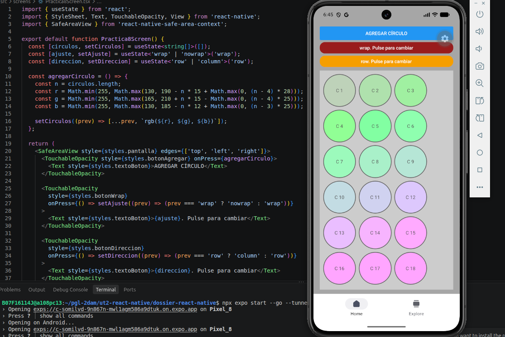


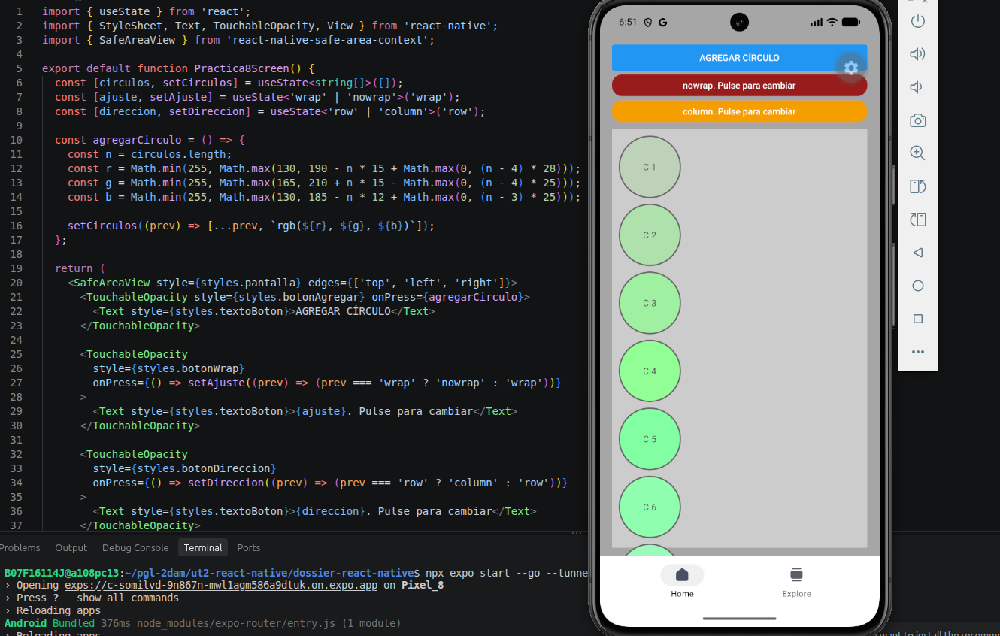


## Práctica 9 - Alineación Flexbox y componente Image

En esta práctica se trabaja la distribución dinámica de elementos en pantalla mediante Flexbox y la carga de imágenes desde distintas fuentes en React Native.

### Funcionalidades implementadas
* **Control de `justifyContent`:** Uso de un campo de texto (`TextInput`) para escribir y aplicar en tiempo real valores de alineación sobre el eje principal (`flex-start`, `flex-end`, `center`, `space-between`, `space-around`, `space-evenly`).
* **Control de `alignItems`:** Botonera interactiva (`TouchableOpacity`) que permite alternar la alineación en el eje secundario (`stretch`, `center`, `flex-start`, `flex-end`).
* **Carga de imágenes (`Image`):** Combinación de recursos locales importados mediante `require()` y recursos externos cargados a través de su URL con la propiedad `{ uri: '...' }`.

### Capturas

#### Práctica 9 - Control de alineación e imágenes
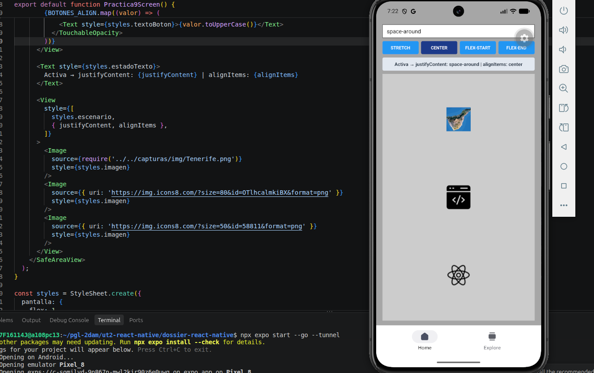

#### Práctica 9.1 - Selector de imagen aleatoria
En esta variante se gestiona un arreglo de imágenes locales mediante `useState`, mostrando una imagen distinta de forma aleatoria cada vez que se pulsa el botón y ajustando su escala con `resizeMode="contain"`.

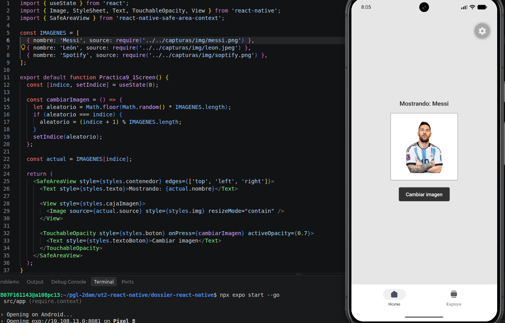

## Práctica 10. Calculadora

Para conservar intactas las prácticas anteriores, he creado el componente reutilizable `src/components/TeclaCalculadora.tsx`, la pantalla principal `src/screens/CalculadoraScreen.tsx` y su ruta correspondiente en `src/app/practica10.tsx`. La interfaz reproduce el diseño de referencia utilizando Flexbox para organizar las filas de botones y estados (`useState` y `useRef`) para gestionar los operandos y la operación activa sin recurrir a `eval()`.

- **`src/components/TeclaCalculadora.tsx`**: Componente táctil construido con `TouchableOpacity` que adapta su color de fondo (gris claro `#9B9B9B`, gris oscuro `#2D2D2D` o naranja `#FF9427`) y su ancho doble para el botón `0`.
- **`src/screens/CalculadoraScreen.tsx`**: Contiene la pantalla de resultado con `adjustsFontSizeToFit`, la distribución de teclas y la lógica aritmética (`+`, `-`, `x`, `/`, `±`, `%` y `AC`).

Código de `src/components/TeclaCalculadora.tsx`:

```tsx
import React from 'react';
import { TouchableOpacity, Text, StyleSheet } from 'react-native';

interface Props {
  texto: string;
  color?: '#2D2D2D' | '#9B9B9B' | '#FF9427';
  anchoDoble?: boolean;
  accion: (textoNumero: string) => void;
}

export const TeclaCalculadora = ({
  texto,
  color = '#2D2D2D',
  anchoDoble = false,
  accion,
}: Props) => {
  return (
    <TouchableOpacity
      activeOpacity={0.7}
      onPress={() => accion(texto)}
      style={[
        styles.boton,
        {
          backgroundColor: color,
          width: anchoDoble ? 168 : 76,
        },
      ]}
    >
      <Text
        style={[
          styles.botonTexto,
          {
            color: color === '#9B9B9B' ? '#000000' : '#FFFFFF',
            textAlign: anchoDoble ? 'left' : 'center',
            paddingLeft: anchoDoble ? 28 : 0,
          },
        ]}
      >
        {texto}
      </Text>
    </TouchableOpacity>
  );
};
```

Código principal de cálculo en `src/screens/CalculadoraScreen.tsx`:

```tsx
const calcular = () => {
  const num1 = Number(numero);
  const num2 = Number(numeroAnterior);

  if (ultimaOperacion.current === undefined || isNaN(num1) || isNaN(num2)) return;

  switch (ultimaOperacion.current) {
    case Operadores.sumar:
      setNumero(`${num1 + num2}`);
      break;
    case Operadores.restar:
      setNumero(`${num2 - num1}`);
      break;
    case Operadores.multiplicar:
      setNumero(`${num1 * num2}`);
      break;
    case Operadores.dividir:
      setNumero(num1 === 0 ? 'Error' : `${num2 / num1}`);
      break;
  }

  setNumeroAnterior('0');
  ultimaOperacion.current = undefined;
};
```

**Problema encontrado y solución:** Al configurar `<StatusBar backgroundColor="#000000" barStyle="light-content" />`, TypeScript marcaba en rojo la propiedad `backgroundColor` debido al modo Edge-to-Edge de Expo. Se solucionó eliminando dicha propiedad y aplicando el fondo negro directamente al contenedor principal junto con `StatusBar.currentHeight` en Android.

Resultado:

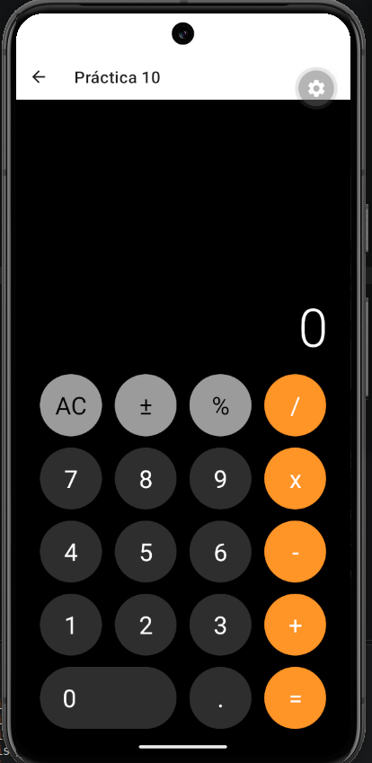

## Práctica 11. Hook personalizado para la calculadora

En esta práctica he separado la lógica de la calculadora de su interfaz mediante la creación de un hook personalizado llamado `useCalculadora.ts`. De esta manera, he mantenido el funcionamiento de la Práctica 10, pero he organizado mejor el código, separando los estados y las funciones de la pantalla principal.

### Funcionalidades implementadas

- **Creación del hook personalizado (`useCalculadora.ts`):** He creado el archivo `src/hooks/useCalculadora.ts` para trasladar toda la lógica de la calculadora.
- **Gestión de estados (`useState`):** El hook mantiene los estados `numero` y `numeroAnterior`, que almacenan los operandos utilizados en las operaciones.
- **Gestión de referencias (`useRef`):** He utilizado `useRef` para conservar la última operación seleccionada (`sumar`, `restar`, `multiplicar` o `dividir`) sin provocar renderizados adicionales.
- **Extracción de funciones:** He trasladado al hook las funciones `limpiar`, `construirNumero`, `positivoNegativo`, `calcularPorcentaje`, `botonDividir`, `botonMultiplicar`, `botonRestar`, `botonSumar` y `calcular`.
- **Integración en la pantalla:** He modificado `src/screens/CalculadoraScreen.tsx` para importar y utilizar `useCalculadora()`, obteniendo de él los estados y las funciones necesarios para controlar los botones.
- **Conservación del componente reutilizable:** He mantenido `src/components/TeclaCalculadora.tsx` sin modificaciones, ya que sigue encargándose de representar las teclas y gestionar sus pulsaciones.

### Organización de los archivos

- `src/hooks/useCalculadora.ts`: Contiene los estados, las referencias y las funciones que controlan el funcionamiento de la calculadora.
- `src/screens/CalculadoraScreen.tsx`: Contiene la interfaz gráfica y utiliza el hook personalizado.
- `src/components/TeclaCalculadora.tsx`: Mantiene el componente reutilizable de las teclas.

### Resultado

La calculadora mantiene el diseño y las operaciones de la Práctica 10, pero ahora tiene el código mejor organizado y separado en archivos según su responsabilidad.


## Práctica 12. Color aleatorio con confirmación

En esta práctica he creado una pantalla que permite cambiar el color de fondo de forma aleatoria, mostrando una alerta para confirmar si quiero aplicar el nuevo color. También he añadido la posibilidad de escribir un color manualmente mediante un cuadro de diálogo creado con `Modal` y `TextInput`, evitando depender de paquetes nativos de terceros.

### Funcionalidades implementadas

- **Selección aleatoria de colores:** He creado una lista de colores y utilizo `Math.random()` y `Math.floor()` para seleccionar uno al azar.
- **Confirmación del cambio:** Al pulsar el botón «Cambiar de color», aparece una alerta (`Alert.alert`) indicando el color propuesto, con las opciones «Aceptar» y «Cancelar».
- **Aplicación del color:** Si pulso «Aceptar», se actualiza el fondo de la pantalla mediante `setFondo()`. Si pulso «Cancelar», se conserva el color anterior.
- **Introducción manual de colores:** He añadido un botón «Escribir un color» que abre una ventana de diálogo mediante el componente `Modal`.
- **Uso de `TextInput`:** Dentro del diálogo he incorporado un campo de texto para escribir el nombre de un color CSS.
- **Control de la ventana:** He añadido los botones «Cancelar» y «Aceptar» para cerrar el diálogo o aplicar el color introducido.

### Componentes y estados utilizados

- `useState`: Permite controlar el color de fondo, la visibilidad del diálogo y el texto del color introducido.
- `Alert`: Muestra la alerta de confirmación del cambio de color.
- `Modal`: Crea una ventana de diálogo compatible con Expo y Android.
- `TextInput`: Permite introducir manualmente el color.
- `Button`: Permite ejecutar las acciones de cambiar el color, escribirlo, aceptar o cancelar.

### Organización de los archivos

- `screens/Practica12Screen.tsx`: Contiene la pantalla, los estados, las funciones y los componentes necesarios para realizar la práctica.

### Resultado

He conseguido crear una pantalla que permite cambiar el fondo a un color aleatorio previa confirmación. También puedo introducir manualmente un color y aplicarlo mediante un diálogo personalizado.

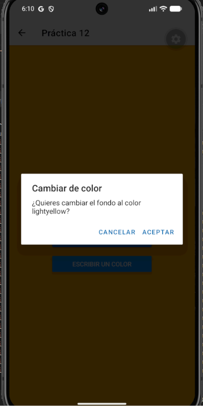

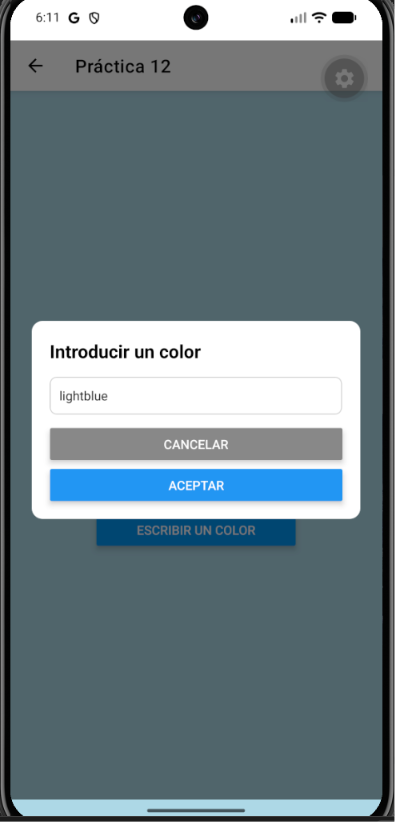

## Práctica 13. Introducir el color

En esta práctica he creado una pantalla que permite introducir manualmente un color mediante un diálogo personalizado. Cuando escribo un color válido y pulso «Aceptar», el fondo de la pantalla cambia. Si pulso «Cancelar», se cierra el diálogo sin modificar el fondo.

También he incorporado un componente `Switch` para practicar el uso de controles booleanos en React Native.

### Funcionalidades implementadas

- **Introducción manual de colores:** He añadido un botón «Introducir color» que abre una ventana de diálogo mediante el componente `Modal`.
- **Uso de `TextInput`:** He incorporado un campo de texto para escribir el nombre de un color CSS o un código hexadecimal.
- **Validación del color:** He creado una comprobación para aceptar nombres de colores incluidos en la lista o códigos hexadecimales válidos de tres o seis caracteres.
- **Aplicación del color:** Si el valor introducido es válido y pulso «Aceptar», se actualiza el fondo mediante `setFondo()`.
- **Cancelación del diálogo:** Si pulso «Cancelar», se cierra la ventana sin cambiar el color de fondo.
- **Control de errores:** Si el campo está vacío o el color no es válido, aparece una alerta informando del problema.
- **Uso de `Switch`:** He añadido un interruptor que permite activar o desactivar una opción. Su estado se controla mediante `value` y `onValueChange`, y su indicador cambia de color con `thumbColor`.

### Componentes y estados utilizados

- `useState`: Permite controlar el color de fondo, la visibilidad del diálogo, el texto introducido y el estado del interruptor.
- `Modal`: Crea una ventana de diálogo personalizada.
- `TextInput`: Permite escribir el color que se quiere aplicar.
- `Switch`: Permite activar o desactivar una opción.
- `Alert`: Muestra mensajes cuando el color introducido no es válido.
- `Button`: Permite abrir el diálogo, aceptar el color o cancelar la operación.

### Organización de los archivos

- `screens/Practica13Screen.tsx`: Contiene la pantalla, los estados, la validación del color y los componentes necesarios para realizar la práctica.

### Resultado

He conseguido crear una pantalla que permite introducir un color manualmente, comprobar que sea válido y aplicarlo al fondo. Además, he practicado el uso del componente `Switch` para controlar una opción mediante un interruptor.

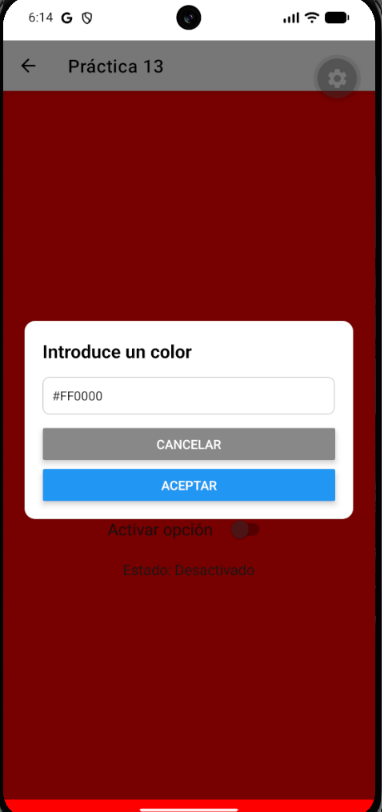

## Práctica 14. Borde activado por Switch

### Objetivo
Reproducir un control mediante un componente `Switch` que permita activar y desactivar un borde rojo alrededor de la pantalla. Además, crear un formulario controlado para introducir los datos de una persona.

### Desarrollo

**1. Switch para activar el borde**

Se utiliza el componente `Switch` de React Native junto con `useState` para controlar si el borde está activado.

- Cuando está desactivado, el indicador es de color marrón.
- Cuando está activado, el indicador es de color naranja.
- Al activarlo, aparece un borde rojo alrededor de la pantalla.
- Al desactivarlo, el borde desaparece.

Se utilizan las propiedades `trackColor`, `thumbColor`, `value` y `onValueChange`.

**2. Formulario de persona**

Se crea un formulario controlado mediante `useState` con los siguientes campos:

- Nombre: campo de texto.
- Edad: campo numérico almacenado inicialmente como texto.
- Casado: interruptor de tipo `Switch`.
- Jubilado: interruptor de tipo `Switch`.

Se define el tipo `DatosPersona` para establecer los tipos de datos de cada campo.

**3. Actualización de los campos**

Se crea una función reutilizable llamada `cambiarCampo`, utilizando `keyof DatosPersona` y genéricos de TypeScript para actualizar los diferentes campos del formulario.

**4. Validación y envío**

Al pulsar el botón «Enviar formulario», se comprueba que:

- El nombre no esté vacío.
- La edad no esté vacía.
- La edad sea un número válido y mayor que cero.

Para convertir la edad se utiliza `Number()` y para comprobar que sea un número finito se utiliza `Number.isFinite()`.

Si los datos son correctos, se muestra una alerta con toda la información introducida. Si hay algún error, se muestra una alerta indicando qué debe corregirse.

### Componentes y conceptos utilizados

- `View`
- `Text`
- `TextInput`
- `Switch`
- `Button`
- `Alert`
- `StyleSheet`
- `useState`
- Tipos e interfaces de TypeScript
- Funciones genéricas
- Formularios controlados
- Validación de datos


### Resultado

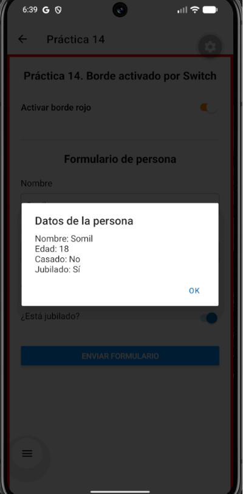


## Práctica 15. Completar el formulario

### Objetivo
Completar el formulario de persona utilizando los componentes de React Native y mostrar los datos introducidos en un resumen final. Además, utilizar `FlatList` para representar una lista de personas.

### Desarrollo

**1. Formulario de persona**

Se crea un formulario controlado mediante `useState` con cuatro campos:

- Nombre: campo de texto mediante `TextInput`.
- Edad: campo numérico mediante `TextInput`.
- Casado: interruptor mediante `Switch`.
- Jubilado: interruptor mediante `Switch`.

Se utiliza el tipo `DatosPersona` para definir los tipos de datos de cada campo.

**2. Actualización de los campos**

Se implementa la función reutilizable `cambiarCampo`, utilizando `keyof DatosPersona` y genéricos de TypeScript para actualizar los valores del formulario.

**3. Validación y registro**

Al pulsar el botón «Añadir persona», se comprueba que:

- El nombre no esté vacío.
- La edad no esté vacía.
- La edad sea un número válido y mayor que cero.

Si los datos son correctos, se crea un objeto de tipo `Persona` y se añade al estado mediante `setPersonas`.

Después de registrar una persona, los campos del formulario se limpian.

**4. Lista de personas con FlatList**

Se utiliza `FlatList` para mostrar las personas registradas.

Se emplean las siguientes propiedades:

- `data`: contiene el array de personas.
- `renderItem`: representa los datos de cada persona.
- `keyExtractor`: identifica cada elemento mediante su ID.
- `ListHeaderComponent`: muestra el número de personas registradas.
- `ListEmptyComponent`: muestra un mensaje cuando la lista está vacía.
- `ItemSeparatorComponent`: añade separación entre los elementos.

**5. Resumen final**

Se incorpora el botón «Mostrar resumen final», que muestra mediante una alerta los datos de todas las personas registradas:

- Nombre.
- Edad.
- Estado civil.
- Situación de jubilación.

### Componentes y conceptos utilizados

- `View`
- `Text`
- `TextInput`
- `Switch`
- `Button`
- `FlatList`
- `Alert`
- `StyleSheet`
- `useState`
- Tipos y funciones genéricas de TypeScript.
- Formularios controlados.
- Validación de datos.
- Listas virtualizadas.

### Resultado

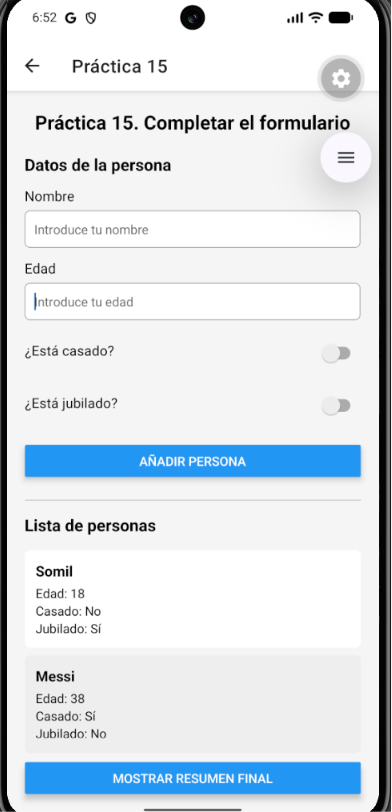